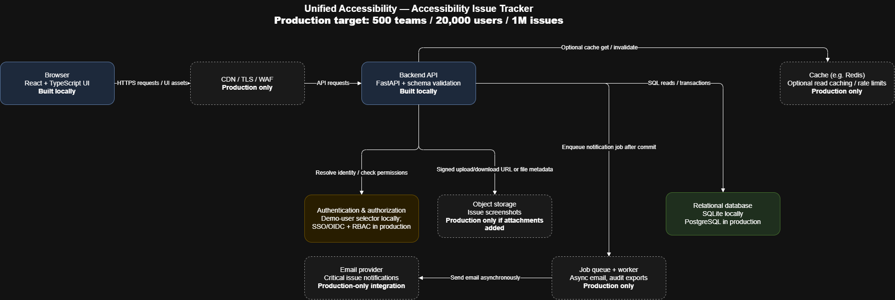
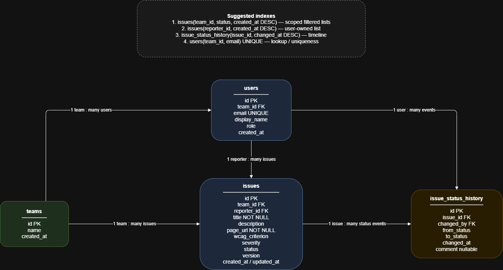
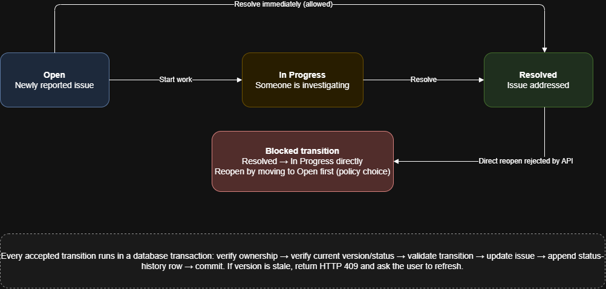

# Unified Accessibility — Accessibility Issue Tracker Architecture

## 1. Scope and assumptions

The production design targets 500 teams, approximately 20,000 users, up to 1 million issues, and bursts of hundreds of issues per minute. The local implementation uses a smaller deployment while preserving the same API boundaries, data model concepts, validation, workflow rules, and ownership checks.

**Local implementation:** React + TypeScript + Vite, FastAPI, SQLAlchemy, SQLite, and pytest. Two seeded demo users replace real authentication; this is for local demonstration only.

**Production proposal:** React frontend behind a CDN/TLS/WAF layer; FastAPI service; PostgreSQL; OIDC/SSO authentication and role-based authorization; optional Redis cache and rate limiting; private object storage for screenshots; and a durable queue with a worker for email notifications.

## 2. System architecture

The browser sends HTTPS requests to the API. In production, a CDN/TLS/WAF layer serves static assets and protects the public entry point. The API validates inputs, derives identity from the authenticated session or token (or selected seeded demo user locally), checks access, enforces business rules, and commits database transactions. The browser must never be trusted to supply an authoritative owner ID.



### Issue creation flow

1. The user submits a form containing a title, HTTP(S) page URL, description, WCAG criterion, and severity.
2. The frontend performs helpful early validation and sends `POST /api/issues`.
3. The API validates the request schema and URL, identifies the signed-in user, checks team membership and permissions, and applies defaults such as `status=Open`. Invalid input returns `400` or `422` with field-level errors; unauthenticated requests return `401` and unauthorized requests return `403` where appropriate.
4. The API inserts the issue in a database transaction and commits it. In production, a Critical-issue notification is arranged after commit; email is not sent inside the request transaction.
5. On success, the API returns `201 Created`. The UI displays the new issue and announces “Issue created” in a persistent `role="status"` / `aria-live="polite"` region without moving focus.
6. On failure, the UI preserves entered values, displays an error summary and inline field errors, and announces a concise failure message. For validation failures, focus may move to the error summary or first invalid field.

### Status-change flow

1. The user selects a new status on the issue detail page. The frontend sends `PATCH /api/issues/{id}/status` with the requested status and current `version`.
2. The API loads the issue within the caller's authorized scope. An issue outside that scope returns `404`, avoiding disclosure that another user's issue exists.
3. The API checks the requested transition against the workflow. An invalid transition returns `409 Conflict` with a clear error code and message; neither the issue nor its history is changed.
4. For a valid transition, a transaction checks the version/current state, updates the status and `updated_at`, increments `version`, and appends an `issue_status_history` row containing the actor, previous status, next status, and timestamp.
5. If another user updated the issue first, the version check fails and the API returns `409 Conflict`. The UI explains that the issue changed elsewhere and offers a refresh rather than silently overwriting the other update.
6. On success, the UI refreshes the displayed status and history and announces the change through a live region.

## 3. Data model

The ER diagram shows the main entities, relationships, and status-history model.



Core tables:

- `teams(id, name, created_at)`
- `users(id, team_id, email, display_name, role, created_at)`
- `issues(id, team_id, reporter_id, title, description, page_url, wcag_criterion, severity, status, version, created_at, updated_at)`
- `issue_status_history(id, issue_id, changed_by, from_status, to_status, changed_at, comment)`

Use foreign keys, `NOT NULL` constraints for required fields, a unique constraint on normalized user email (or `(team_id, email)` if emails may be shared across tenants), and database checks for enumerated severity/status values where supported. The API validates HTTP/HTTPS URLs and allowed status transitions. History rows are append-only. In production, tenant scoping must apply to every issue query, not only list endpoints.

Recommended indexes:

1. `issues(team_id, status, created_at DESC)` supports team-scoped status filtering and recent-first pagination.
2. `issues(reporter_id, created_at DESC)` supports a user's own issue list.
3. `issue_status_history(issue_id, changed_at DESC)` supports the issue timeline.
4. A unique index on `users(team_id, email)` (or globally unique email) supports identity lookup and prevents duplicates.

Use cursor/keyset pagination for large lists, with a stable sort such as `(created_at, id)`. Avoid fetching all one million rows at once.

## 4. API proposal

All endpoints require a signed-in user in production. Local demo sign-in selects one of the two seeded identities; it is not production authentication. All issue operations derive the caller from the server-side session/token and scope queries by authorized team or owner.

| Method and path | Purpose | Access | Typical errors |
|---|---|---|---|
| `GET /api/me` | Return the current demo/authenticated user | Signed-in user | `401` |
| `GET /api/issues?status=&severity=&cursor=` | List authorized issues with filters and pagination | Own issues locally; team-scoped permissions in production | `400`, `401` |
| `POST /api/issues` | Create an issue | Signed-in user | `400`, `401`, `403`, `422` |
| `GET /api/issues/{id}` | Read an issue and its status history | Authorized owner/team member | `401`, `404` |
| `PATCH /api/issues/{id}` | Edit permitted issue fields | Authorized owner/team member | `400`, `401`, `404`, `409`, `422` |
| `PATCH /api/issues/{id}/status` | Change status and append history | Authorized owner/team member | `401`, `404`, `409`, `422` |

Example error response:

```json
{
  "error": {
    "code": "INVALID_STATUS_TRANSITION",
    "message": "An issue cannot move from Resolved directly to In Progress.",
    "fields": {
      "status": "Choose an allowed next status."
    }
  }
}
```

Use a consistent error envelope. Never accept a trusted `owner_id` from the request body. In the local version, query with both the issue ID and the current demo user's ID, for example `WHERE id = :issue_id AND reporter_id = :current_user_id`; return `404` if no authorized row is found. Apply the equivalent team policy to production endpoints.

## 5. Status workflow and concurrent updates



| Current status | Allowed next status |
|---|---|
| Open | In Progress, Resolved |
| In Progress | Resolved, Open |
| Resolved | Open |

This workflow permits reopening a resolved issue, but blocks `Resolved → In Progress` directly; the user must reopen it to `Open` first. This is a product assumption rather than a fixed requirement. Enforce it in the backend service, never only in the UI. Every successful status change creates one history row in the same transaction.

If two users update an issue concurrently, use optimistic concurrency with an integer `version` (or a conditional update against the old status/version). The first valid update succeeds; a stale request receives `409 Conflict` and the user is prompted to refresh.

## 6. Scale and reliability

Likely early bottlenecks are unbounded list queries, missing compound indexes, large response payloads, and synchronous work in issue creation. Use pagination, selective columns, appropriate indexes, request limits, and query-plan inspection. At one million issues, do not load full histories into list responses; fetch history only on the detail page. Hundreds of writes per minute are a reasonable workload for PostgreSQL when transactions are short and queries are indexed.

If the database is temporarily unavailable, return a retryable `503 Service Unavailable` with a request/correlation ID. Do not pretend the write succeeded or announce success. In production, configure bounded connection pools, timeouts, health checks, backups, and restore testing. Retry only safe/idempotent operations automatically; avoid blind retries that could create duplicate issues.

For screenshot attachments, add private object storage and an `issue_attachments` table containing metadata, object key, uploader, size, MIME type, and timestamp. Validate file type and size, use short-lived signed URLs, and do not trust a client-provided filename or content type alone.

For Critical-issue email, add a durable queue and worker plus an email provider. Commit the issue first, then enqueue a notification using a transactional outbox or another reliable post-commit mechanism. The worker sends email asynchronously with retry/backoff and idempotency, so email latency or provider failure does not delay issue creation.

## 7. Accessibility architecture

The API returns machine-readable error codes and field errors. The frontend maps these to plain-language messages next to fields and in an error summary. Associate errors using `aria-describedby`, mark invalid controls with `aria-invalid="true"`, and focus the summary or first invalid field on validation failure. Success and failure announcements use a persistent `role="status"` / `aria-live="polite"` region without moving focus. Use `role="alert"` sparingly for urgent errors.

Use semantic HTML, visible labels, native buttons/selects/inputs, a skip link, one main heading, meaningful page titles, visible keyboard focus, text labels for severity/status (not color alone), sufficient contrast, and responsive layout at 320px and 200% zoom. Keyboard and automated accessibility-check results are recorded in `ACCESSIBILITY.md`.

## 8. Local versus production

| Concern | Local assignment | Production design |
|---|---|---|
| Frontend | React + TypeScript + Vite | Same UI served through CDN/static hosting |
| API | FastAPI | FastAPI behind TLS/WAF/load balancing; multiple instances as needed |
| Database | SQLite file | PostgreSQL with backups and monitoring |
| Identity | Two seeded demo users | OIDC/SSO, sessions/tokens, role and tenant checks |
| Cache, queue, files | Not required for the core demo | Optional Redis, durable queue/worker, private object storage |
| Deployment | Run locally using free tools | Managed or self-hosted production services based on operational needs |

Production-only components are justified by scale, security, and asynchronous side effects. They are not required in the local implementation unless needed for a core feature.

## 9. Technology choices and trade-offs

| Layer | Selected technology | Alternative considered | Trade-offs & rationale |
|---|---|---|---|
| **Backend API** | **FastAPI (Python 3.12)** | Django REST Framework (DRF) or Node.js / Express | Django/DRF provides an out-of-the-box admin UI and ORM, but brings significant monolithic weight, rigid session defaults, and slower synchronous execution. Express.js is lightweight but requires stitching together separate validation (Zod/Joi) and ORM libraries without native OpenAPI generation. **FastAPI** was chosen for its native async performance, robust type validation via Pydantic, automatic interactive OpenAPI documentation (`/api/docs`), and clean dependency injection for identity and database scoping. |
| **Frontend** | **React 18 + TypeScript + Vite** | Next.js (SSR) or Vanilla TypeScript | Next.js introduces server runtime dependencies, edge complexity, and deployment overhead that are unjustified for an authenticated audit application where public SEO is unnecessary. Vanilla TypeScript avoids library dependencies but requires hand-crafting DOM reconciliation and accessible focus management primitives. **React + TypeScript + Vite** provides instant HMR, declarative accessible component hierarchy, strict compile-time type safety, and a compact static bundle that can be hosted on any CDN or static storage layer. |
| **Database** | **SQLite (Local) / PostgreSQL (Prod)** | MongoDB (Document) or DynamoDB (NoSQL) | Document/NoSQL databases offer flexible schemaless ingestion, but lack strict multi-table referential integrity (`RESTRICT` foreign keys), atomic multi-table transactions (critical for committing an issue update and its append-only history record together), and standard relational indexing. **SQLite** was chosen for local development because it is serverless, zero-configuration, and file-persisted across restarts. **PostgreSQL** is specified for production to support row-level locking, high-volume concurrent writers across 500 teams, connection pooling, and point-in-time recovery. |

## 10. Diagramming tool

The architecture and workflow diagrams were authored and exported using **diagrams.net (draw.io)**. High-resolution exported images are embedded directly within this document:
- System Architecture: [`docs/architecture.png`](docs/architecture.png)
- Entity-Relationship Model: [`docs/er-diagram.png`](docs/er-diagram.png)
- Issue Status Workflow: [`docs/status-workflow.png`](docs/status-workflow.png)

